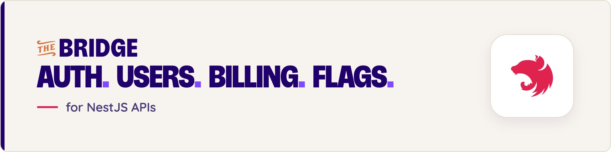

<p align="center">
  <a href="https://thebridge.dev/?utm_source=github&utm_medium=readme&utm_campaign=bridge-nestjs"><picture><source media="(prefers-color-scheme: dark)" srcset="https://raw.githubusercontent.com/thebridgedev/bridge-nestjs/main/.github/assets/banner.png"></picture></a>
</p>

<p align="center">
  <a href="https://www.npmjs.com/package/@nebulr-group/bridge-nestjs"></a>
  <a href="https://github.com/thebridgedev/bridge-nestjs/blob/main/LICENSE"></a>
</p>

<p align="center">
  <a href="https://thebridge.dev/?utm_source=github&utm_medium=readme&utm_campaign=bridge-nestjs"><b>Website</b></a> ·
  <a href="https://thebridge.dev/docs/quickstart/nestjs/?utm_source=github&utm_medium=readme&utm_campaign=bridge-nestjs"><b>Quickstart</b></a> ·
  <a href="https://thebridge.dev/docs/?utm_source=github&utm_medium=readme&utm_campaign=bridge-nestjs"><b>Docs</b></a> ·
  <a href="https://thebridge.dev/docs/ai-assistants/mcp/?utm_source=github&utm_medium=readme&utm_campaign=bridge-nestjs"><b>Set up with your AI assistant</b></a>
</p>

# The Bridge for NestJS

`@nebulr-group/bridge-nestjs` protects a NestJS API with Bridge: token verification, flag-gated endpoints, plan limits and tenant data, as a module, a guard and decorators.

**[The Bridge](https://thebridge.dev/?utm_source=github&utm_medium=readme&utm_campaign=bridge-nestjs)** is a hosted backend for SaaS apps. It gives you sign-in (passwords, magic links, passkeys, social login and SSO), multi-tenant workspaces with roles, Stripe subscriptions with plan limits, and feature flags, all managed from one dashboard. Your AI coding assistant can set it up for you through the [Bridge MCP server](https://thebridge.dev/docs/ai-assistants/mcp/?utm_source=github&utm_medium=readme&utm_campaign=bridge-nestjs).

> **Let your AI assistant set it up.** Connect the [Bridge MCP server](https://thebridge.dev/docs/ai-assistants/mcp/?utm_source=github&utm_medium=readme&utm_campaign=bridge-nestjs) to Claude, Cursor, Copilot or Gemini CLI and ask it to add Bridge to your app. Not using MCP? Run `npx @nebulr-group/bridge-cli guide add-login` in your project: it detects your framework from `package.json` and prints the steps for your assistant to follow. `npx @nebulr-group/bridge-cli doctor` checks the result.

## The one rule for app code

**Every gate in app code is a flag.** A link, a page, a button, an endpoint: if some people get it and others do not, the code asks a flag, and the flag's rule says why: a privilege (`privileges contains "users:write"`), a plan feature (`bridge:billing.entitlement.analytics eq true`) or a rollout. App code never reads a role, a privilege list, the plan or a plan feature to decide what someone may see or do.

Two things are not gates and are not flags: **numbers** are plan limits (`<QuotaGate>` in the browser, `@RequireQuota` on the backend), and **permission on one specific record** stays in app code ("only the author edits their post").

Before calling the work done, run `npx @nebulr-group/bridge-cli check gates` in the project. It lists every direct role, privilege, plan or plan-feature check with the flag to use instead. Fix each one.

In NestJS, an endpoint is `@RequireFeatureFlag('…')` on the handler (or a route rule with `featureFlag`).

## Structure

```
bridge-nestjs/
├── bridge-nestjs/    # The publishable @nebulr-group/bridge-nestjs library
├── demo/             # Demo NestJS application
├── docker-compose.yml
└── Dockerfile
```

## Development

Builds and tests run in a container:

```bash
docker compose run --rm bridge-nestjs zsh
# inside the container
cd bridge-nestjs && npm install && cd ..
npm run build        # the library
npm test             # unit tests, against a signing issuer in memory
npm run e2e:test     # the demo app end to end
```

`npm run e2e:test` runs the demo against a signing issuer in memory: tokens signed as Bridge signs them, the four lanes of the revocation list, flags and usage. Point it at a real issuer too with `E2E_ISSUER` (your test app's issuer); add `E2E_ACCESS_TOKEN`, a person's token for that app, to check the signed-in path. Never commit either.

## Demo App

`demo/` shows the whole surface:

- a public health check that reports whether the revocation list is current (`/`: `current.reads` and `current.writes`, with the limits it fails closed at);
- the caller (`/me`);
- flag-gated tickets, counted with `@Meter` (`/tickets`);
- the team, read and managed as the caller with the management client (`/team/*`);
- a webhook receiver (`/webhooks/bridge`).

### Environment Variables

```bash
BRIDGE_ISSUER=https://…/identity-access/apps/<your app id>
BRIDGE_APP_KEY=…              # "count this" and the management client
BRIDGE_WEBHOOK_SECRETS=whsec_…
BRIDGE_DEBUG=true
```

### Demo: access taken away reaches this server (TBP-240)

What a change in Bridge does to the demo's own server. Local development needs nothing but `BRIDGE_ISSUER`.

Without Bridge, in memory (always runs): `npm run e2e:test`, the `TBP-240` block of `e2e/demo.e2e.spec.ts`:

| Step | Shows |
|---|---|
| A-C | An Editor's token creates a ticket; after the role change to Viewer the old token is refused (`401 revoked`) within seconds; the renewed token reads tickets but creating is `403 FEATURE_OFF`; another person is untouched |
| D | Suspending a person across the app refuses their tokens in every workspace within 10 seconds, writes included |
| Fail closed | With the list unreachable: 80 s behind still served; past 90 s writes are `503`, reads still served, `/` says `current.writes: false`; past 5 minutes reads are `503` too and `/` says `ok: false`; back on the list, served again without a restart |

On a real Bridge (stage, or a local bridge-server stack): `PARITY_ISSUER=… PARITY_APP_KEY=… npm run e2e:parity -- access-taken-away` runs `e2e/parity/access-taken-away.parity.spec.ts` (role change ADMIN to MEMBER, suspension and resume, health limits) on people and workspaces it makes for the run (see `e2e/parity/README.md` for the key's privileges).

By hand, for a recorded demo:

1. `cd demo && BRIDGE_ISSUER=<test app's issuer> BRIDGE_APP_KEY=<its key> npm run start` and open `http://localhost:3000/`: `current` is `{ reads: true, writes: true }`.
2. Sign Anna in (the Svelte example or the hosted page) and call `GET /me` with her token: `200`.
3. In the dashboard change Anna's role: within seconds `GET /me` with the old token is `401` (`code: revoked`); the browser renews and goes on with the new role.
4. Suspend Anna from the dashboard: within 10 seconds every call with her token is `401`, and renewing fails.
5. Block the demo's way to Bridge (for example, a firewall rule for the issuer's host): after 90 s `POST /tickets` is `503` and `/` says `writes: false`; after 5 minutes every signed-in call is `503` and `/` says `ok: false`.

## Publishing

```bash
# Build and pack the library
npm run package

# This creates @nebulr-group/bridge-nestjs-x.x.x.tgz in the root
```

## Documentation

See [bridge-nestjs/README.md](./bridge-nestjs/README.md) for the full API and [`learning/`](learning/README.md) for the guides.

## Learn more

- [Quickstart](https://thebridge.dev/docs/quickstart/nestjs/?utm_source=github&utm_medium=readme&utm_campaign=bridge-nestjs)
- [Authentication](https://thebridge.dev/docs/auth/nestjs/?utm_source=github&utm_medium=readme&utm_campaign=bridge-nestjs)
- [Feature flags](https://thebridge.dev/docs/feature-flags/nestjs/?utm_source=github&utm_medium=readme&utm_campaign=bridge-nestjs)
- [Plan limits](https://thebridge.dev/docs/plan-limits/nestjs/?utm_source=github&utm_medium=readme&utm_campaign=bridge-nestjs)
- [Tenant data](https://thebridge.dev/docs/bridge-service/nestjs/?utm_source=github&utm_medium=readme&utm_campaign=bridge-nestjs)
- [Multi-tenancy](https://thebridge.dev/docs/multi-tenancy/nestjs/?utm_source=github&utm_medium=readme&utm_campaign=bridge-nestjs)
- [Error handling](https://thebridge.dev/docs/error-handling/nestjs/?utm_source=github&utm_medium=readme&utm_campaign=bridge-nestjs)
- [Examples](https://thebridge.dev/docs/examples/nestjs/?utm_source=github&utm_medium=readme&utm_campaign=bridge-nestjs)

## Other Bridge packages

| Package | For |
|---|---|
| [`@nebulr-group/bridge-svelte`](https://www.npmjs.com/package/@nebulr-group/bridge-svelte) | SvelteKit |
| [`@nebulr-group/bridge-react`](https://www.npmjs.com/package/@nebulr-group/bridge-react) | React |
| [`@nebulr-group/bridge-nextjs`](https://www.npmjs.com/package/@nebulr-group/bridge-nextjs) | Next.js |
| [`@nebulr-group/bridge-angular`](https://www.npmjs.com/package/@nebulr-group/bridge-angular) | Angular |
| [`@nebulr-group/bridge-express`](https://www.npmjs.com/package/@nebulr-group/bridge-express) | Express |
| [`@nebulr-group/bridge-cli`](https://www.npmjs.com/package/@nebulr-group/bridge-cli) | CLI for people and AI agents |
| [`@nebulr-group/bridge-auth-core`](https://www.npmjs.com/package/@nebulr-group/bridge-auth-core) | Any JavaScript app (core) |

## License

[MIT](https://github.com/thebridgedev/bridge-nestjs/blob/main/LICENSE) © Nebulr. Built by [The Bridge](https://thebridge.dev/?utm_source=github&utm_medium=readme&utm_campaign=bridge-nestjs).
